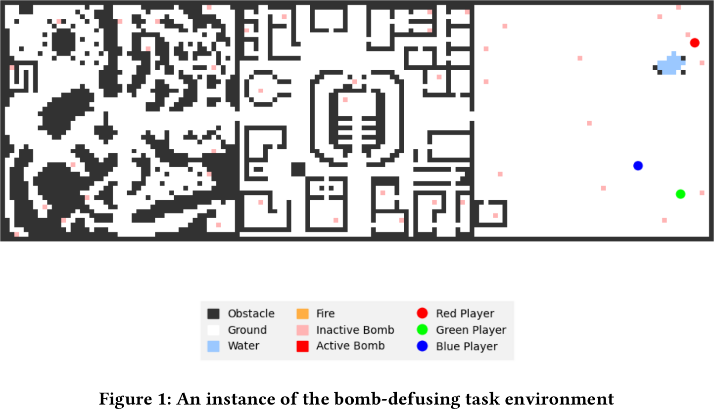
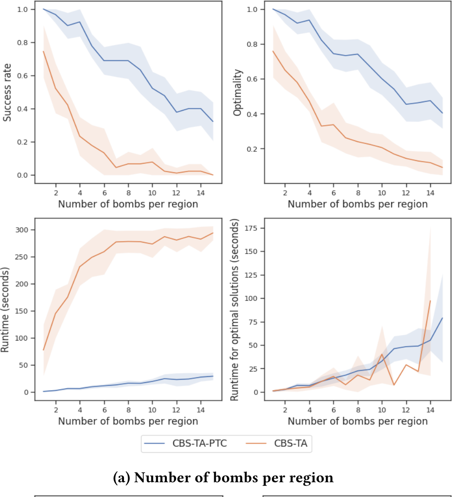
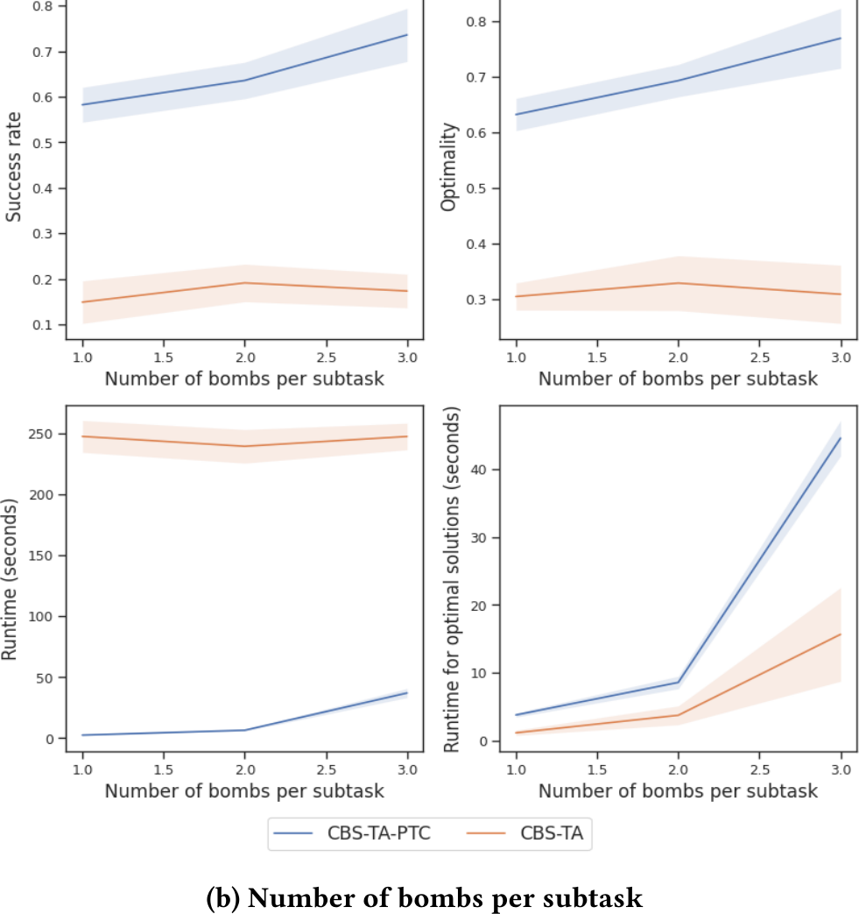
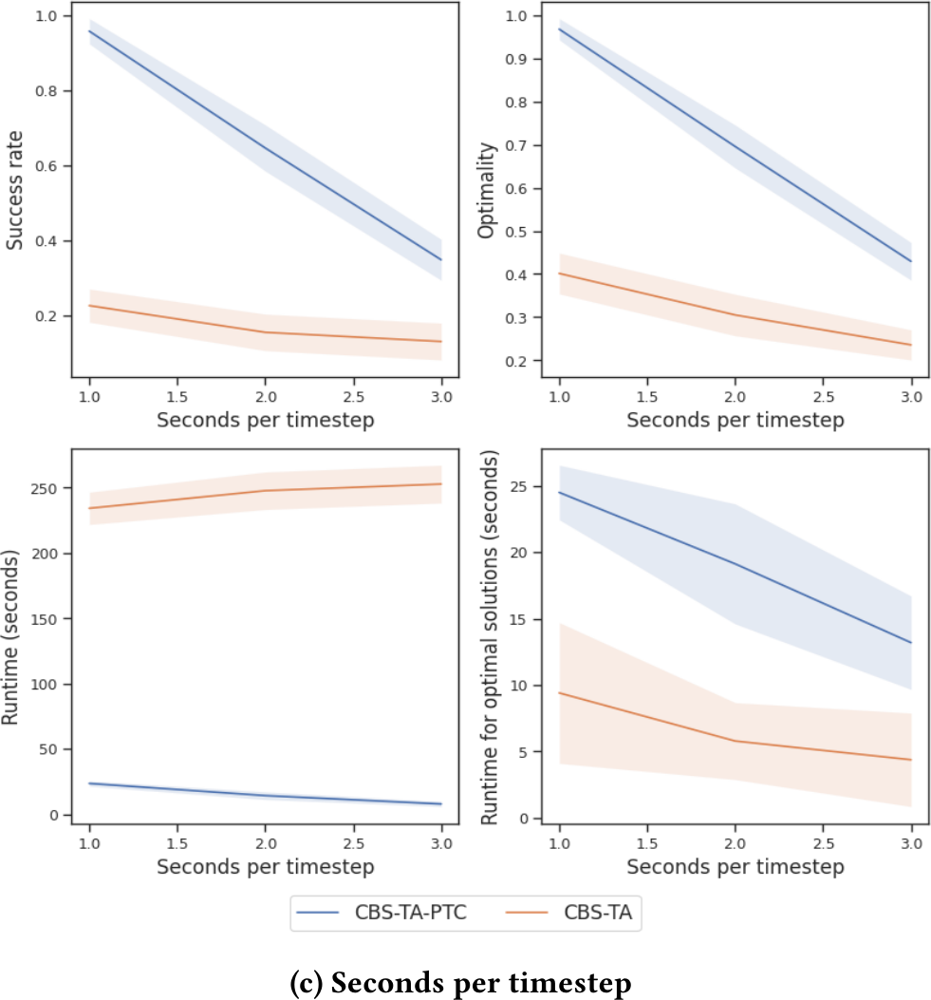
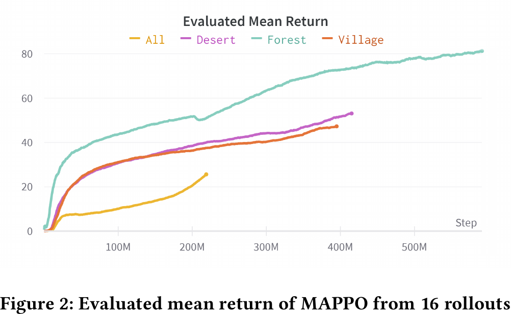

# Paper Review: CBS-TA-PTC

> **Paper:** Yu Quan Chong, Jiaoyang Li, and Katia Sycara, “Optimal Task Assignment and Path Planning using Conflict-Based Search with Precedence and Temporal Constraints,” *AAMAS 2024*; full version on arXiv.  
> **Links:** [arXiv record](https://arxiv.org/abs/2402.08772) · [Full PDF](https://arxiv.org/pdf/2402.08772) · [AAMAS 2024 proceedings paper](https://www.ifaamas.org/Proceedings/aamas2024/pdfs/p2210.pdf)

## Short verdict

CBS-TA-PTC is highly relevant to **General Interaction-Aware Goal Assignment** because it judges a task assignment by the system-level return obtained after path planning and simulated execution, rather than only by independent robot–goal distances. It also integrates assignment, task ordering, timing, and path planning in one search framework.

Its main limitation is computational: it finds assignment quality by enumerating candidate assignments, planning them, and rolling them out in an environment. It does not learn a reusable, cheap representation of collective assignment quality. The practical subtask decomposition used to control this cost sacrifices completeness and optimality. More importantly for our project, robot–robot collisions are disabled in the main experiment, so the paper does not actually demonstrate assignment choices that reduce congestion, crossings, or bottleneck competition.

> **Main takeaway:** retain the paper’s execution-informed definition of assignment quality, but replace repeated exhaustive planning and rollout with a scalable interaction-aware quality model. Use CBS-TA-PTC or another strong MAPF solver as an oracle for small-instance labels and evaluation.

## Research lens from the summer project

The target research problem is not simply to replace Hungarian matching with a neural network. Classical assignment usually minimizes a sum of independent pairwise costs,

```math
J_{\mathrm{pairwise}}(A)=\sum_{i,j}c_{ij}A_{ij},
```

whereas the desired objective is closer to

```math
A^*=\arg\min_A J_{\mathrm{system}}
\big(A,\mathrm{Planner}(A),\mathcal E\big).
```

The literature-review question is therefore:

> **What does this paper believe a good assignment is, and does that definition capture the collective consequences after planning and execution?**

CBS-TA-PTC is useful precisely because it moves from pairwise assignment cost toward downstream system return.

## 1. What exactly is the paper solving?

The paper defines **Task Assignment and Path Finding with Precedence and Temporal Constraints (TAPF-PTC)**. An instance contains:

- an undirected graph $G=(V,E)$;
- $N$ agents with start vertices;
- $M$ goals;
- an action and execution duration at each goal;
- precedence and temporal constraints among goals;
- a user-defined reward function and environment dynamics.

Each goal must be assigned to an agent, and one agent may receive a sequence of multiple goals. The method jointly determines

```math
\boxed{
\text{task assignment}
+\text{task order}
+\text{collision-free paths}
+\text{execution timing}
}
```

while maximizing the user-defined return.

This is richer than ordinary one-to-one robot–goal matching. A goal is not merely a destination; it includes an action that occupies the robot for a specified number of timesteps. The solution must satisfy four constraint types:

| Constraint type | Meaning |
|---|---|
| Absolute temporal range | A goal must start or finish within a specified time window |
| Precedence | One goal action must occur before another |
| Inter-goal temporal | The execution/completion times of two goals must remain within a specified temporal relationship |
| Vertex/edge | Robots cannot occupy the same vertex simultaneously or traverse an edge in opposite directions at the same time |

The paper’s example domain has three agents defusing bombs. Bombs contain ordered wire sequences, countdowns, fuse deadlines, and dependency chains. Each robot can cut only two of the three wire colors, so assignment, ordering, timing, and capability must agree.



**Figure 1 (cropped from Fig. 1 of the full arXiv paper, PDF p. 5).** The graph-based bomb environment contains Forest, Village, and Desert regions, active/inactive bombs, obstacles, and three agents. The scenario makes task dependencies and timing visible, but the experiment permits agents to share a node and therefore does not test robot–robot collision interaction.

## 2. What representation of assignment quality does it use?

### 2.1 Assignment quality is downstream return

CBS-TA-PTC does **not** score an assignment using only

```math
\sum_i d(r_i,g_{A(i)})
```

or a standard MAPF metric such as makespan or sum of path costs. For each candidate assignment, the low-level solver generates paths, the environment rolls out the resulting trajectory, and the algorithm sums rewards across agents and timesteps. Conceptually,

```math
Q(A)
=
\sum_{t=0}^{T}\sum_{i=1}^{N}\gamma^t r_i(t)
=
R\big(S,\mathrm{Planner}(A),\mathcal E\big).
```

The evaluation pipeline is

```text
candidate assignment
        ↓
constrained low-level path planning
        ↓
environment rollout
        ↓
user-defined return
        ↓
priority in the CBS constraint tree
```

The root and child constraint-tree nodes are ordered by this return. Therefore, two assignments with similar travel distance may receive different scores if their executions differ in feasibility, timing, conflict resolution, or task completion.

### 2.2 The environment is an oracle, not a learned evaluator

The paper assumes an oracle—typically a user-designed Gymnasium-style RL environment—that can simulate a planned solution and calculate its return. The algorithm knows whether an assignment is good only after it has:

1. generated the assignment;
2. planned paths for it;
3. rolled the paths out in the environment;
4. evaluated the reward.

This is a strong definition of assignment quality, but an expensive representation. CBS-TA-PTC does not learn a function such as

```math
f_\theta(\mathcal R,\mathcal G,\mathcal E,A)\rightarrow \hat Q(A)
```

that can generalize across instances or estimate quality without full planning and simulation.

### 2.3 The reward defines “good assignment”

In the bomb domain, fully defusing a bomb produces a team reward proportional to the length of its wire sequence; for example, an RGB bomb yields

```math
3\times 10=30.
```

An assignment is therefore good when the resulting execution completes high-value bombs while respecting capabilities, dependencies, countdowns, and fuse deadlines. A short geometric assignment can be poor if it creates an infeasible task order or misses a deadline.

This supports our project’s central claim:

```math
\boxed{\text{assignment quality should be defined by collective execution quality.}}
```

## 3. Does it account for robot–robot interaction?

### In the algorithm: yes

CBS-TA-PTC inherits explicit collision reasoning from Conflict-Based Search. It can detect and resolve:

- **vertex conflicts:** two agents occupy the same vertex at the same timestep;
- **edge conflicts:** two agents traverse the same edge in opposite directions during the same timestep.

Its high-level search resolves conflicts in this priority order:

```math
\boxed{
\text{absolute temporal}
\rightarrow
\text{precedence}
\rightarrow
\text{inter-goal temporal}
\rightarrow
\text{vertex/edge}
}
```

Thus the general formulation can make assignment quality depend on coupled multi-agent execution rather than only independent robot–goal costs.

### In the main experiment: no

The bomb-defusing evaluation explicitly allows multiple agents to work on bombs at the same node during the same timestep. The authors state that collisions are not considered because the experiment has only three agents and collision is not a key factor in that setup.

This distinction is critical:

> **The framework can reason about robot–robot path conflicts, but the reported experiment does not validate interaction-aware assignment under congestion, path crossing, corridor competition, or blocking.**

The demonstrated coupling is mainly among task dependencies, deadlines, timing, and robot capabilities. Our intended interaction set is different: robot–robot traffic created by the assignment itself.

## 4. How CBS-TA-PTC works

### 4.1 Task partitioning

When $M$ is much larger than $N$, the goals are sorted using a task-specific heuristic and partitioned into subtasks containing $\beta$ goals. Each subtask is solved sequentially, using past subtask solutions as context.

In the bomb experiment, goals are sorted by fuse length and the number of bombs per subtask is restricted to 1–3 to keep assignment enumeration feasible.

### 4.2 High-level search

For one subtask, the algorithm:

1. enumerates all possible task assignments;
2. creates a root constraint-tree node for every assignment;
3. uses the low-level solver to generate paths;
4. rolls out each solution and calculates its return;
5. repeatedly expands the node with the highest return;
6. identifies the highest-priority violated constraint;
7. creates child nodes with additional constraints and replans the affected agent;
8. stops when it obtains a solution with the oracle’s maximum return.

### 4.3 Low-level planning

Multi-Label A* generates a minimum-sum-of-path-costs solution for a fixed assignment under the current constraints. A HiGHS linear-programming module prunes constraint-tree nodes that are already infeasible.

### 4.4 Exactness versus practical scalability

If the entire task is treated as one subtask, the paper proves completeness and optimality under its stated assumptions, including a fixed terminal timestep. However, the practical decomposition into multiple heuristic subtasks is **incomplete and suboptimal** for the original full task.

This is not a minor implementation detail. It is the direct price paid for controlling the combinatorial assignment space.

## 5. What has the paper genuinely solved well?

| Aspect | What the paper achieves | Relevance to our project |
|---|---|---|
| Assignment objective | Optimizes downstream user-defined return | Strong conceptual match |
| Assignment–planning coupling | Searches task assignment and paths together | Strong evidence that the two stages are coupled |
| Temporal structure | Handles deadlines, execution durations, precedence, and inter-goal timing | More expressive than our initial one-shot formulation |
| Collision handling | Supports CBS vertex/edge conflict resolution | Useful oracle mechanism in theory |
| Exactness | Complete and optimal when the whole task is one subtask | Strong small-instance oracle |
| Comparison with MARL | Avoids learning path planning from scratch | Useful warning about sample efficiency |

### 5.1 It formalizes an execution-informed assignment objective

The strongest contribution for our research is the explicit recognition that

```math
\boxed{\text{task assignment and downstream planning are tightly coupled.}}
```

The paper also shows that makespan or sum of path costs need not represent the application’s real objective. A reward-defined system return can express task success more directly.

### 5.2 It handles task constraints that ordinary MAPF omits

CBS-TA-PTC integrates nonzero action duration, absolute deadlines, relative timing, and precedence with assignment and path planning. This is a genuine capability, especially for manufacturing, service, and cooperative manipulation tasks where reaching a location is not the end of the task.

### 5.3 It clearly outperforms the adapted CBS-TA baseline in this domain

The adapted CBS-TA baseline uses only vertex/edge constraints and tries to resolve task failures through much less informative constraint-tree expansion. CBS-TA-PTC generally obtains higher success rate and optimality ratio. At the environment setting closest to the Minecraft timing model—two seconds per timestep—the reported success rate is approximately 0.65 for CBS-TA-PTC versus 0.15 for CBS-TA.



**Figure 3a (cropped from Fig. 3(a) of the full arXiv paper, PDF p. 7).** As the number of bombs per region increases, CBS-TA-PTC’s success and optimality degrade more gradually than CBS-TA’s. The runtime curves also expose the cost of increasingly difficult instances.



**Figure 3b (cropped from Fig. 3(b) of the full arXiv paper, PDF p. 7).** Larger subtasks improve success and optimality because more constraints are considered jointly, but runtime grows sharply. This is direct evidence of the quality–computation tradeoff introduced by task partitioning.



**Figure 3c (cropped from Fig. 3(c) of the full arXiv paper, PDF p. 7).** Harder timing conditions reduce success and optimality. CBS-TA-PTC remains substantially stronger than CBS-TA, showing the value of explicitly representing temporal and precedence conflicts.

### 5.4 It provides a useful expert-search alternative to learning from scratch

MAPPO is trained for approximately two weeks on a Quadro RTX 6000, yet does not solve even the simplified bomb task optimally. The expected maximum return is 300 per region, while the plotted evaluated returns remain far below that value.



**Figure 2 (cropped from Fig. 2 of the full arXiv paper, PDF p. 6).** MAPPO’s evaluated mean return after hundreds of millions of steps illustrates the sample-efficiency problem that motivates a planning-based expert. It does not prove that learning is generally unsuitable; it shows that end-to-end MARL from scratch is a weak fit for this particular structured task.

## 6. Limitations relative to General Interaction-Aware Goal Assignment

### 6.1 It searches assignments instead of learning or formulating their collective structure

The high-level method evaluates all possible assignments for a subtask before conflict-tree expansion. Runtime therefore grows combinatorially with the number of goals per subtask. The paper itself identifies assignment enumeration and environment rollout as the dominant bottleneck.

Our target is closer to predicting

```math
(\mathcal R,\mathcal G,\mathcal E,A)
\xrightarrow{f_\theta}
\hat J(A),
```

so the system can anticipate that an assignment will create congestion or blocking without running a full planner for every candidate.

### 6.2 Practical task partitioning loses global guarantees

The experimental method limits each subtask to one to three bombs. Sequentially solving these pieces may miss dependencies or assignment tradeoffs that matter across subtask boundaries. Completeness and optimality apply only when the entire task is solved as one subtask.

### 6.3 It has no reusable representation or cross-instance generalization

Every new problem instance requires a new combinatorial search. There is no learned or analytic representation that transfers knowledge about bottlenecks, traffic patterns, or harmful assignment structures across maps, robot counts, and goal configurations.

### 6.4 The main evaluation removes the interaction we care about most

Only three agents are used, and collisions between agents are disabled. The paper therefore does not show the central phenomenon for our project:

```math
A_1\rightarrow\text{severe crossing/congestion},
\qquad
A_2\rightarrow\text{smooth collective motion}.
```

Its results cannot establish that the assignment mechanism improves robot–robot traffic interaction.

### 6.5 Assignment and planning are not experimentally isolated

Because assignment and path planning are solved together, an improvement in return cannot be cleanly attributed to a better assignment representation. Our first study should keep the downstream planner fixed so differences in execution can be traced to the assignment.

### 6.6 The formulation is discrete and deterministic

The method operates on a graph and cannot directly address environment stochasticity. The authors explicitly identify stochastic events as a case better suited to learning and propose using CBS-TA-PTC as an expert for imitation learning. Extension to continuous motion and physical robots remains open.

### 6.7 The experimental baseline set is narrow for our question

The comparisons are MAPPO and an adapted CBS-TA. They do not include Euclidean Hungarian, shortest-path Hungarian, bottleneck assignment such as OM, optimal transport, or an interaction-aware learned assignment model under the same downstream planner.

## 7. What we should take from this paper

### 7.1 Core formulation: evaluate assignment through execution

Keep the causal chain

```math
\text{assignment}
\rightarrow
\text{fixed planner}
\rightarrow
\text{collective execution}
\rightarrow
J_{\mathrm{system}}.
```

This is the paper’s most important contribution to our research direction.

### 7.2 Use CBS as a teacher or oracle

For small problems, enumerate or sample candidate assignments $A_1,\ldots,A_K$. Run a strong MAPF planner for each one and record labels such as

```math
y(A)=
[M,\,SOC,\,N_{\mathrm{conflict}},\,T_{\mathrm{wait}},\,C_{\mathrm{crossing}},\,C_{\mathrm{bottleneck}}].
```

Then train an interaction-aware predictor

```math
f_\theta(\mathcal R,\mathcal G,\mathcal E,A)\rightarrow \hat y(A).
```

CBS supplies expensive ground truth during dataset generation; the deployed assignment model avoids evaluating every candidate with CBS.

### 7.3 Preserve separate metrics even if training uses one scalar objective

A possible scalar cost is

```math
J=
\lambda_M M
+\lambda_S SOC
+\lambda_C N_{\mathrm{conflict}}
+\lambda_W T_{\mathrm{wait}}
+\lambda_X C_{\mathrm{crossing}}
+\lambda_B C_{\mathrm{bottleneck}}.
```

However, makespan, flowtime, conflicts, waiting, crossings, and congestion should also be reported separately. Otherwise, a high score will not reveal which aspect of collective behavior improved.

### 7.4 Fix the planner to isolate assignment quality

Use the same downstream planner for every method:

```math
A_{\mathrm{Hungarian}}\rightarrow P,
\quad
A_{\mathrm{OM}}\rightarrow P,
\quad
A_{\mathrm{interaction}}\rightarrow P.
```

This makes the scientific claim testable: any execution improvement comes from assignment, not from changing the planner.

### 7.5 Baselines and experimental setup

Recommended baselines:

1. random assignment;
2. Euclidean-distance Hungarian;
3. obstacle shortest-path Hungarian;
4. bottleneck/makespan assignment such as OM;
5. small-instance exhaustive or CBS-based oracle;
6. interaction-aware model with representation ablations.

Recommended scenarios:

- random starts to formation goals;
- two-group region exchange;
- narrow-passage competition;
- opposing corridor traffic;
- dense cluster redistribution;
- obstacle-heavy maps;
- unseen robot counts, goal layouts, and map topologies.

Recommended measurements:

- assignment runtime;
- planner runtime;
- executed makespan;
- sum of costs/flowtime;
- conflict count;
- accumulated waiting;
- path-crossing count;
- bottleneck occupancy or congestion;
- success rate and scalability.

### 7.6 A concrete research hypothesis

```math
\boxed{
\begin{aligned}
&\text{A model of relationships among robots, goals, and map topology can predict}\\
&\text{downstream multi-robot execution quality more accurately than independent}\\
&\text{pairwise distance, while avoiding full planner rollouts for every assignment.}
\end{aligned}}
```

This hypothesis directly extends CBS-TA-PTC’s execution-informed objective while addressing its main scalability gap.

## 8. Position relative to the other reviewed papers

| Paper | Representation of assignment quality | Main value for our project | Main missing piece |
|---|---|---|---|
| OM | Independent obstacle-aware robot–goal path cost | Strong scalable pairwise baseline | No collective interaction model |
| CBS-TA-PTC | Return after planning and environment rollout | System-level oracle objective | Combinatorial evaluation; collision interaction not tested |
| Hyper-SAMARL | Learned higher-order interaction representation and execution reward | Representation-learning reference | Different dynamic task; weak one-shot assignment isolation and scale |

The remaining gap is a method that is simultaneously:

```math
\boxed{
\text{general}
+\text{interaction-aware}
+\text{assignment-specific}
+\text{scalable}
+\text{generalizable}
}
```

## 9. Final assessment

| Question | Assessment |
|---|---|
| Does it go beyond independent robot–goal distance? | Yes—quality is downstream return |
| Does it couple assignment and path planning? | Yes, explicitly |
| Does the formulation model robot–robot collision conflicts? | Yes |
| Do the main experiments test robot–robot collision interaction? | No |
| Does it handle precedence, action duration, and temporal constraints? | Strongly yes |
| Is it complete and optimal in its practical partitioned form? | No |
| Is it complete and optimal when the whole task is one subtask? | Yes, under the stated assumptions |
| Does it learn a reusable assignment-quality representation? | No |
| Does it scale without task partitioning? | No; assignment enumeration is combinatorial |
| Is it useful for our project? | Yes—as a formulation reference, oracle, and small-instance baseline |

CBS-TA-PTC solves an important part of the broader problem: it shows how an assignment can be judged by the actual return of the multi-robot plan rather than by a hand-designed pairwise distance. What remains open—and is central to our project—is how to represent or learn that downstream interaction-aware quality cheaply enough to generalize and scale, especially when assignments create robot–robot congestion and structured traffic conflicts.

## Figure and reuse note

The five embedded images are cropped excerpts from the cited AAMAS 2024 paper and are included for private academic commentary and analysis. Copyright remains with the authors or rights holder. If this repository becomes public or is used in a publication, verify the applicable reuse policy or replace the excerpts with original redrawn diagrams.

## Reference

Y. Q. Chong, J. Li, and K. Sycara, “Optimal Task Assignment and Path Planning using Conflict-Based Search with Precedence and Temporal Constraints,” in *Proceedings of the 23rd International Conference on Autonomous Agents and Multiagent Systems (AAMAS 2024)*, Auckland, New Zealand, May 6–10, 2024, pp. 2210–2212. Full version: [arXiv:2402.08772](https://arxiv.org/abs/2402.08772).
